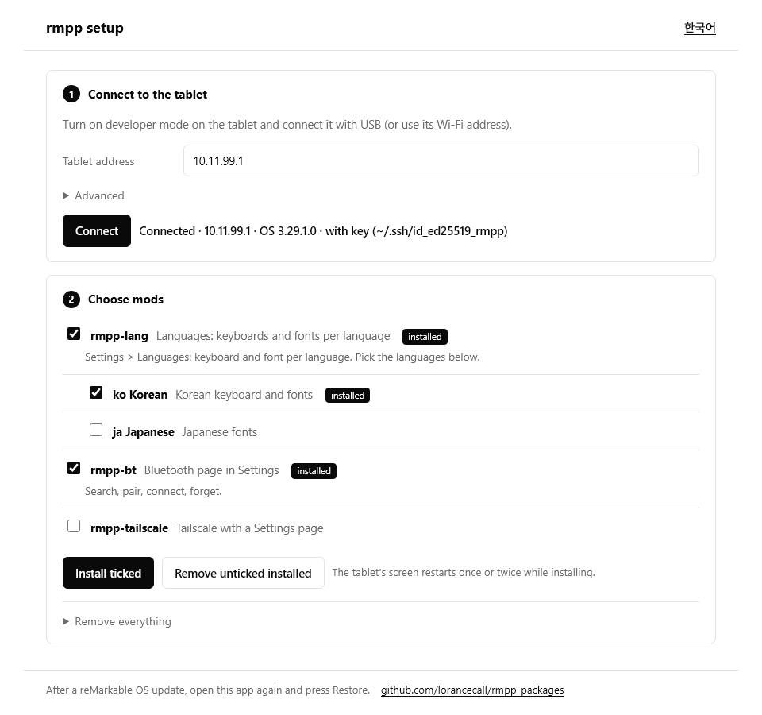

# rmpp-packages

Add-ons for the reMarkable Paper Pro (OS 3.29), packaged so they install in one go. Code I tuned for my own
tablet; a [Vellum](https://github.com/vellum-dev/vellum) package repository only because that was the easiest way
to gather it in one place. Overview: **[lorancecall.github.io/rmpp](https://lorancecall.github.io/rmpp/)**.

- **Not an official repository**, tested on my own tablet only, no support promised.
- **Take what is useful**: feel free to move a package to Vellum's main repository or anywhere else (keep the
  license, GPL-3.0). No need to ask.

## What is in it

| Add-on | What it does |
|---|---|
| [rmpp-lang](https://github.com/lorancecall/rmpp-lang) | Keyboards (on-screen, Type Folio, Bluetooth, USB) and fonts per language, in Settings > Languages. Each language is its own package: `rmpp-lang-ko` Korean, `-ja`, `-zh`, `-ru`, `-bg` |
| [rmpp-bt](https://github.com/lorancecall/rmpp-bt) | Bluetooth page in Settings, quick-settings toggle, keyboards, Bluetooth on at boot |
| [rmpp-tailscale](https://github.com/lorancecall/rmpp-tailscale) | Tailscale with a Settings page (QR login, devices, updates) and SSH over Tailscale (~70 MB in /home) |
| [rmpp-refresh](https://github.com/lorancecall/rmpp-refresh) | Refresh button in the toolbar and the library sidebar: one tap clears ghosting |
| [rmpp-hwr](https://github.com/lorancecall/rmpp-hwr) | Handwriting recognition on the tablet: lasso to typed text or movable ink text, Convert page (Korean, Chinese, Japanese, English, Latin; ~80 MB) |
| [rmpp-studio](https://github.com/lorancecall/rmpp-studio) | Desktop app to see and control the tablet from a computer; its tablet part is `rmpp-remote` |
| `rmpp-preload` | Loads the add-ons into xochitl at boot, keeps xovi working (installed automatically) |

None of them needs xovi, and they stay on after a reboot ([how](docs/how-it-works.md)). Handwriting data:
[rmpp-hwr-db](https://github.com/lorancecall/rmpp-hwr-db) (CC BY 4.0, contributions welcome).

## Install

1. **Developer mode and the SSH password.** Turning developer mode on **erases the tablet** (sync first):
   Settings > General > Paper Tablet > Software > Advanced > Developer Mode. The password is then in Settings >
   General > Help > About > Copyrights and Licenses. Details and connection problems: [docs/ssh.md](docs/ssh.md).
2. **Run rmpp setup** with the tablet on USB (`10.11.99.1`) or the same Wi-Fi, pick the add-ons, install.

   

   - **Desktop app** (Windows, macOS, Linux): *rmpp setup* from the
     [releases](https://github.com/lorancecall/rmpp-packages/releases) (tags `app-v*`); first-run warning of an
     unsigned app: [app/README.md](app/README.md).
   - **Windows PowerShell** (needs the built-in OpenSSH client):

     ```powershell
     irm https://lorancecall.github.io/rmpp-packages/install-rmpp.ps1 -OutFile install-rmpp.ps1
     powershell -ExecutionPolicy Bypass -File install-rmpp.ps1
     ```

   - **Linux / macOS:**

     ```sh
     curl -fsSL https://lorancecall.github.io/rmpp-packages/install-rmpp.sh -o install-rmpp.sh
     sh install-rmpp.sh
     ```

3. **After every reMarkable OS update**, open the app and press **Restore** (or run the installer again): an OS
   update replaces the system files the add-ons live in.

Every add-on installs what it needs with it (`rmpp-preload` always): [docs/packages.md](docs/packages.md).

- Without rmpp setup (Vellum on the command line): [docs/manual-install.md](docs/manual-install.md)
- The installer's menu, buttons and options: [docs/installer.md](docs/installer.md)

## Remove

- **One add-on:** untick it in rmpp setup and press **Remove unticked installed** (or `vellum del <package>`).
- **Everything:** **Remove everything** in rmpp setup; optionally with the add-ons' settings and data.
- **Before a factory reset or handing the tablet on**, remove everything first: a reset does not remove the
  add-ons' system files.

Step by step, what stays and the command-line versions: [docs/uninstall.md](docs/uninstall.md).

## More

- [docs/packages.md](docs/packages.md): every package, what comes with it, what needs it
- [docs/how-it-works.md](docs/how-it-works.md): how the add-ons load; next to xovi and other mods; where packages come from
- [MODS.md](MODS.md): add a mod to the installer menu
- [docs/forking.md](docs/forking.md): your own package repository and signing key

## License

GPL-3.0-only. `scripts/build-package.sh` is adapted from [vellum-dev/vellum](https://github.com/vellum-dev/vellum).
